# Phase 1 · Get to know Wazuh

## What does Wazuh do, and how does an event travel from the agent to the dashboard?

Wazuh is an open-source security platform. It monitors the devices where its agent is installed (servers, computers, virtual machines) and some cloud services too, and it warns you when something suspicious happens. It mainly does two things:

- **Threat detection:** it collects logs and events from the devices and analyzes them with rules to generate alerts.
- **Compliance and configuration:** it checks whether a device is properly configured according to certain standards, and it detects file changes and vulnerabilities.

It has four components: the **agent**, which is installed on the device and monitors it; the **manager** (the server), which receives and analyzes what the agents send; the **indexer**, which stores and indexes the alerts so they can be searched, and the **dashboard**, which is the web interface.

This is how an event travels. I checked it when I created my own alert (rule 100010):

1. The agent collects the event on the device it is monitoring. In my case, a new line in `/var/log/example.log`.
2. It sends it, encrypted, to the manager on port 1514.
3. The manager, which is the one receiving the events from the agents, decrypts it, decodes it (extracts its fields, like the user or the IP) and evaluates it against a set of rules.
4. When a rule matches, it creates an alert.
5. The alert is stored in the indexer.
6. Finally, the dashboard reads the stored alerts from the indexer to show them to the user.

## What did you try in your lab, and what did you learn from it?

**Installation.** The first thing I did was check which was the latest version of Wazuh, 4.14.9, and that is the one I installed. I chose Docker in single-node mode because I already worked with Docker at Prowler and I feel comfortable with it. I installed the agent on an Ubuntu 24.04 machine created with OrbStack, with the same version as the manager (screenshots 01 to 04).

**What I tried**

- **Changing the `admin` password.** With the agent already installed, I changed the `admin` password, as the documentation recommends, in every place where it had to be changed (screenshots 05 and 06).
- **A detection with FIM.** I created a folder on the agent and configured it to be monitored in real time. Then I created, modified and deleted a file, and I could see the alerts in the dashboard (screenshot 07).
- **A custom decoder and rule.** Wazuh lets you teach it how to read logs from applications it doesn't know. This part was harder for me, because the documentation is split across several pages and I got a bit lost, so I used AI to guide me step by step. I simulated my own application with a log file and, on the manager, I wrote a decoder, which extracts the user and the IP from each line, and a rule, which decides when to generate an alert. I tested it first with `wazuh-logtest`, which shows you how Wazuh understands a sample line without needing the agent. Then I configured the agent to read that file, wrote a line in it and the alert showed up in the dashboard (screenshots 08 and 09).
- **SCA.** I looked at the CIS policy for Ubuntu that Wazuh applies by default, which felt familiar because I already worked with CIS at Prowler, and I went through some of its checks (screenshots 10 and 11).
- **The API.** I also wanted to try the API, because if one day I build something on top of Wazuh, it will be through it. I made a simple request to see the agents from the terminal (screenshot 12).

**What I learned**

- What I liked the most was the custom decoder and rule: even if Wazuh doesn't know the logs of an application, a company can teach it how to read them and when to raise an alert. I also learned that a rule with level 0 doesn't generate an alert: the example in the documentation had it, and I had to raise it to level 3 to see it in the dashboard.
- I reinforced the difference between FIM and SCA: FIM tells you that something has changed, and SCA tells you whether the current configuration is secure. It is very similar to what I did at Prowler.
- With the password change I learned that the `admin` password is stored in several places that have to be kept in sync.

## What was hard, and how did you get past it?

- **The custom decoder and rule.** I set myself the challenge of trying it because I was curious and didn't want to skip it, but the documentation is split across several pages (the decoder in one, the rule in another and the agent configuration in a third) and it was hard for me to understand how everything fit together. After trying for a while, I preferred to use AI to guide me so I wouldn't lose too much time, and I checked every step with `wazuh-logtest` before moving on to the next one.
- **The level 0 rule.** The example rule worked in `wazuh-logtest`, but nothing showed up in the dashboard. I realized that with level 0 Wazuh ignores it and doesn't generate an alert, so I raised it to level 3.
- **The agent's virtual machine.** First I tried to create it with Multipass, but it gave me an error when starting the image (`qemu-img ... Process crashed`) and I didn't fully understand the tool. I switched to OrbStack, which a colleague at Prowler had recommended to me, and it worked on the first try.

## If you had one more day with your lab, what would you explore next, and why?

If I had one more day, I would like to build something small on top of Wazuh, now that I know how to talk to it through its API. One idea I find very interesting is to get the failed SCA checks from all the agents and turn them into a single to-do list to work through, each one with its fix. Wazuh already shows the failed checks and how to fix them, but agent by agent. Putting myself in the shoes of someone who uses Wazuh, I think having them all together, sorted by how many machines they affect and with the option to mark what is already fixed, would help a lot: they would know where to start, how to solve each problem and how much is left.

## Screenshots

### 01. Stack running
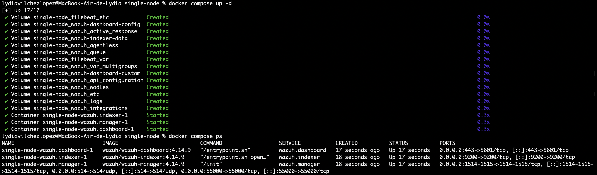

The first step was to bring Wazuh up with Docker. Here we can see the three containers (manager, indexer and dashboard) up and running.

### 02. Dashboard
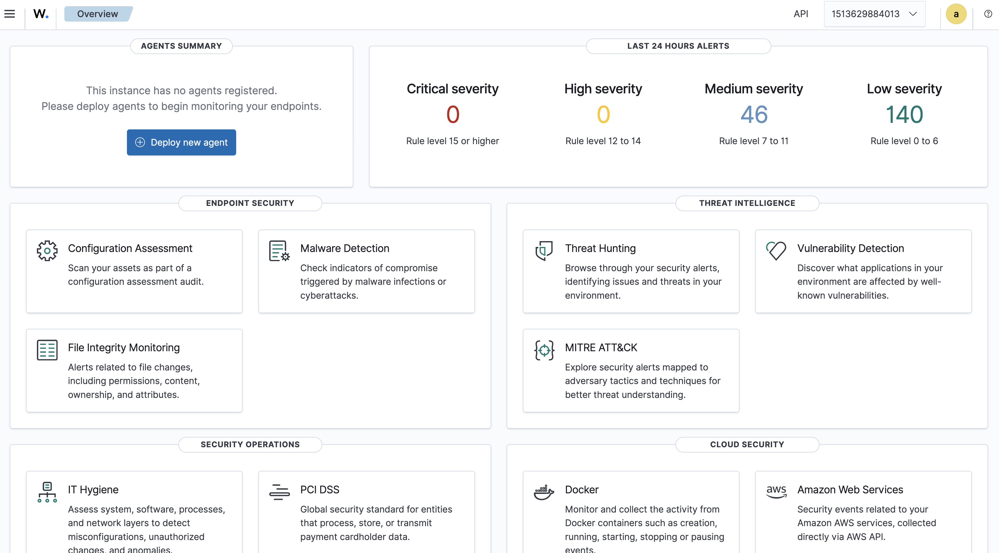

With the containers running I could already log into the dashboard, but there was no agent connected yet.

### 03. Agent installed
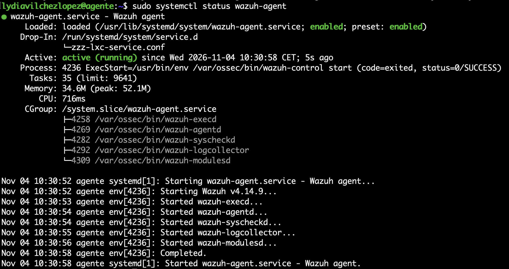

Then I moved on to installing the agent on an Ubuntu machine created with OrbStack. In this screenshot we can see the agent service active and running.

### 04. Agent active in the dashboard
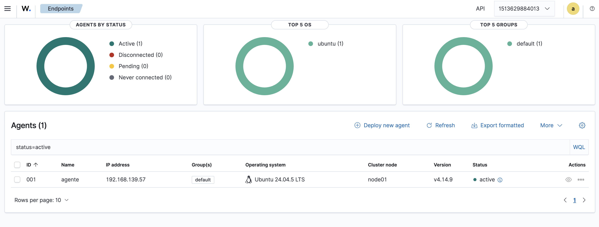

Once the agent was installed, it showed up as active in the dashboard.

### 05. Admin password in the compose file
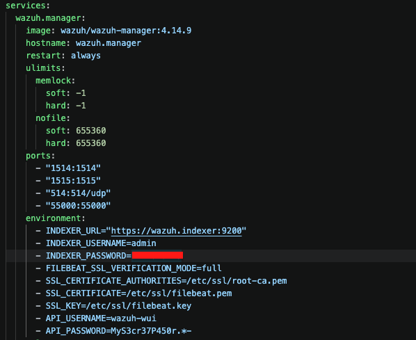

As the Wazuh documentation recommends, I changed the default `admin` password following the steps it describes. One of them is changing it in `docker-compose.yml`, which is what we can see here (I covered it).

### 06. Reloading the security configuration
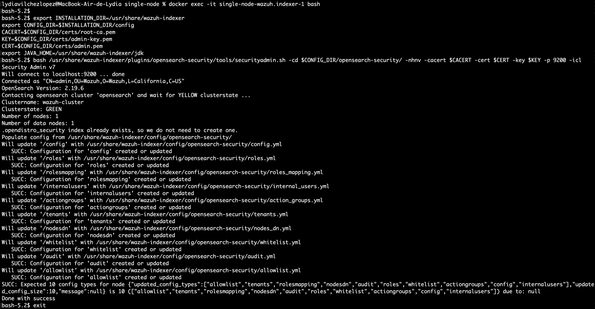

Changing it in the files is not enough, because the indexer keeps the users in its own security configuration. The last step was to reload it with `securityadmin.sh` so it would use the new password. When it finished without errors, I could log into the dashboard with it.

### 07. FIM alerts
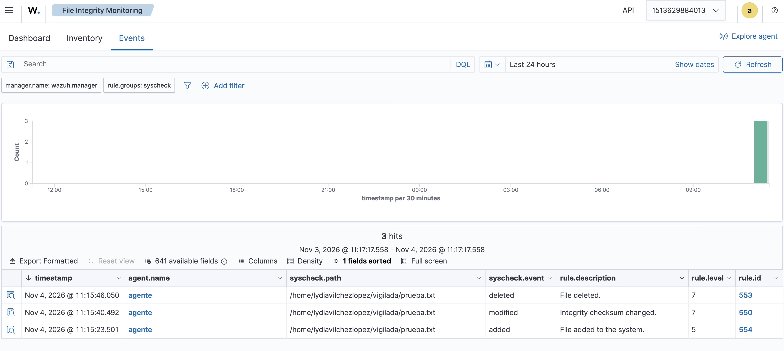

To try FIM, I set up a folder to be monitored in real time and started creating, modifying and deleting a file. The three alerts showed up in the dashboard: file added, modified and deleted.

### 08. Testing the decoder and the rule with logtest
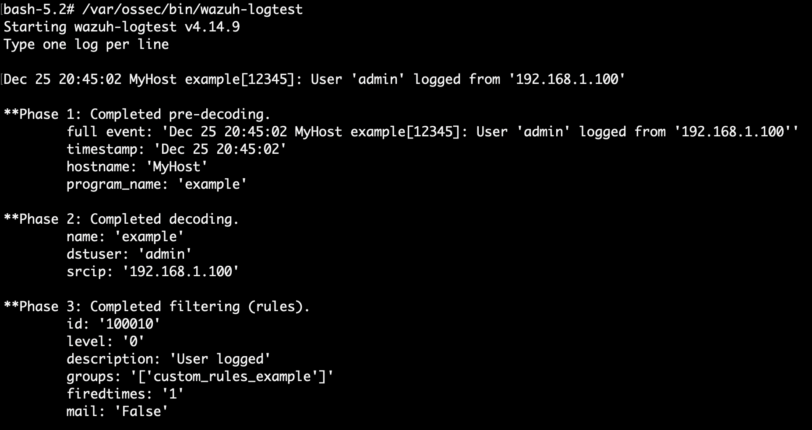

Before using my decoder and my rule for real, I tested them with `wazuh-logtest`. Here we can see how Wazuh understands the log line: it extracts the user and the IP, and my rule matches.

### 09. Alert from my custom rule
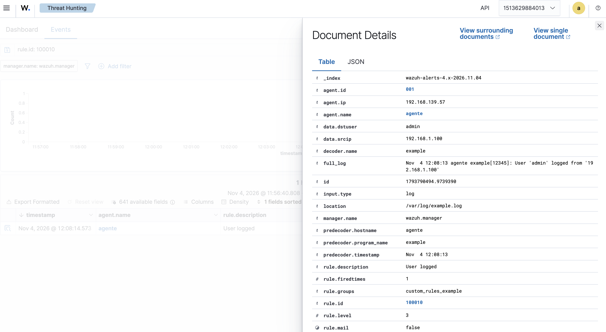

After making the agent read the log file, the alert showed up in the dashboard with the user and the IP that my decoder extracted.

### 10. SCA
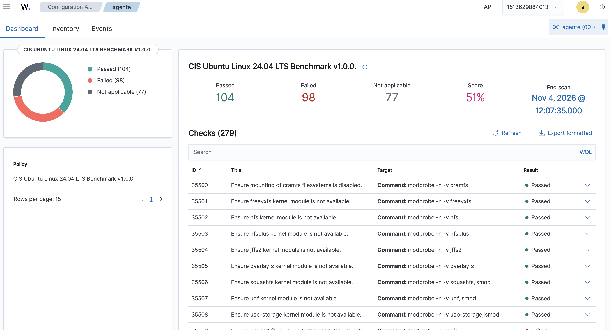

In the dashboard I also looked at the SCA assessment of my agent, with the CIS policy for Ubuntu that Wazuh includes by default.

### 11. A failed SCA check
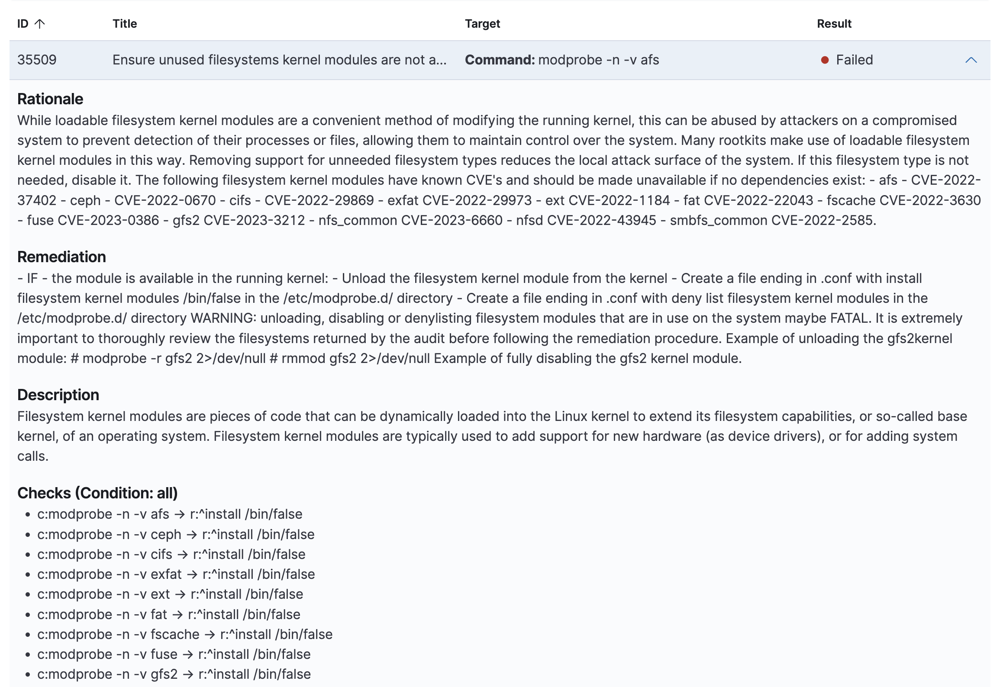

I opened some of the failed checks to see what they check, why they matter and how to fix them.

### 12. Wazuh API
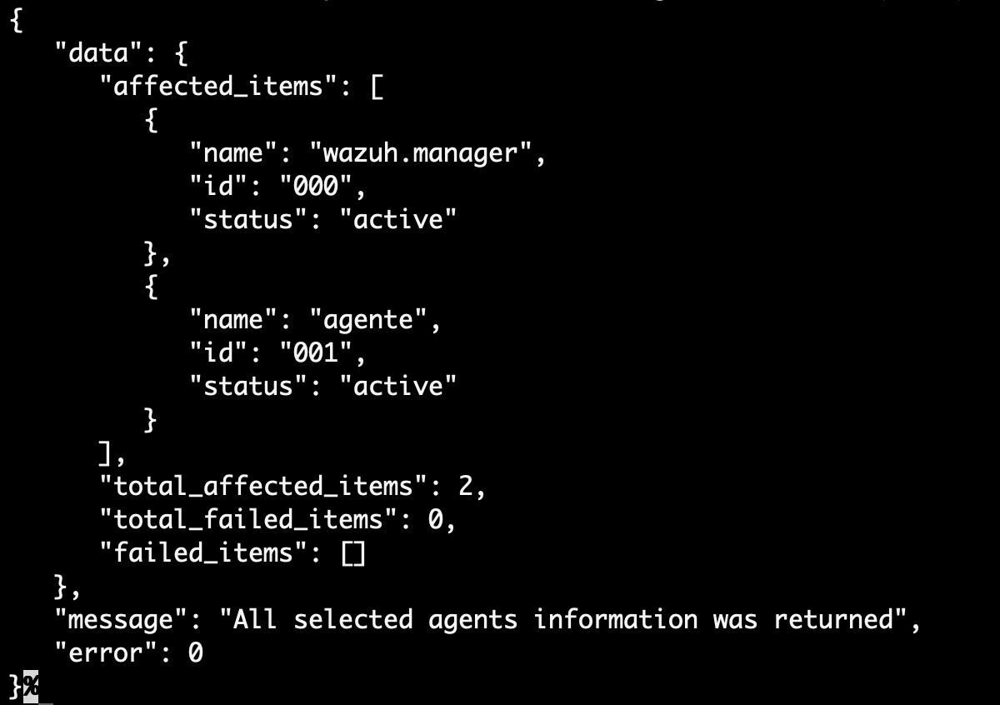

Finally, I tried the API. Here we can see the response when I ask for the list of agents: the manager and my agent, both active.
