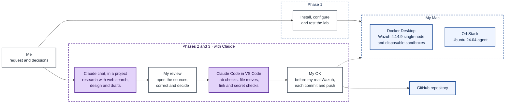
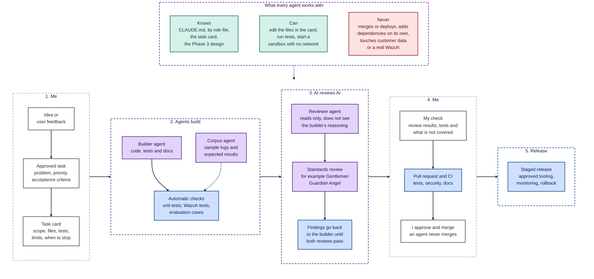

# Phase 4 · Plan how to build it with AI

In this phase I explain how I used AI during the task, and how I would build and run the service I designed in [Phase 3](../phase3/PHASE3.md) with AI agents if I joined a SaaS team tomorrow. The repository contains research, a design, lab evidence and prepared evaluation cases. It does not contain the built service, so everything I say about building it is a **proposal**.

Besides this document, the phase includes:

- The [prompts](agent-direction/prompts.md) that did the most to direct the AI in phases 2 and 3.
- The repository's [CLAUDE.md](../CLAUDE.md), which collects the rules I followed with my agents.
- The two requested diagrams, with their `.mmd` source in the [`diagrams/`](diagrams/) folder.

## 1. How did you use AI in phases 2 and 3, where did it help you and where did you have to correct it?

### How I worked

From Phase 2 on I worked with Claude, with my own Claude subscription, in two ways:

- **The Claude chat, inside a project of my own and with web search.** That is where I researched, designed and wrote the drafts. I saved documents in the project so that each new chat started with the context of the previous ones.
- **Claude Code, inside VS Code on my Mac.** I used it for the lab checks, to move and review the repository files, and for the commits.

My lab is on the same Mac (**checked in my lab**): Wazuh 4.14.9 in Docker Desktop (single-node) and the agent on an Ubuntu 24.04 machine in OrbStack. The Phase 3 sandboxes were standalone containers in the same Docker, with no network.

The following diagram shows how I worked. Phase 1, at the top, goes straight from me to the lab. In phases 2 and 3, at the bottom, every draft goes through my review before it reaches Claude Code, and nothing reaches my real Wazuh or GitHub without my OK. The dashed line shows that Claude Code only works on the lab after my OK.

*Source: [how-i-worked.mmd](diagrams/how-i-worked.mmd).*

I wrote the prompts in Spanish because of the deadline, although I know English would have been better. A colleague on the AI team at Prowler, where I always worked with AI in English, gave me that advice: there is much more documentation in that language. The repository documents are in English.

### Phase 2: the AI researched, I reviewed and chose

I asked Claude for research on real needs of Wazuh users, with the source of each one and the discarded ones with their reasons. Then I repeated the research from scratch with more channels (GitHub issues and how many comments they have, the mailing list, the documentation and community tools), giving priority to what was published in 2026. The notes are in [RESEARCH.md](../phase2/research/RESEARCH.md) and the prompts in [prompts.md](agent-direction/prompts.md#phase-2-research).

When the AI gave me a piece of research, I did not keep just the summary. I opened the links and read the issues, threads and articles each claim came from. I always do this when an AI works for me. I also asked for every claim to have its link in the text itself and, later with Claude Code, for all the links to be checked.

My first idea was an assistant to query your own Wazuh, similar to Lighthouse AI at Prowler. With Claude I compared the candidates: what recent evidence each one had, whether something already covered it, whether AI could be the centre of the service and whether I had experience with it. The final choice, writing decoders and rules for the logs Wazuh does not understand, was mine. I also decided that the service should be general and that Google Workspace should only be an example.

### Phase 3: the AI proposed, the lab decided

The AI helped me organise the design, the diagrams and the evaluation cases. I gave Claude Code the lab checks as a written brief ([lab checks prompt](agent-direction/prompts.md#phase-3-lab-checks)), with these limits:

- Never print passwords or tokens, and ask me for the password with `read -rs`.
- Explain each block in one sentence and wait for my OK before touching my real Wazuh.
- Test in a new container with no network, without touching my containers.
- Stop and tell me why if Wazuh's test bank did not work after two attempts.
- Do not commit.

The results are in [`phase3/evidence/`](../phase3/evidence/).

### Where it helped me

- **Research coverage.** The research covered many more threads, issues and articles than I would have read alone in a day.
- **Running the checks within the limits.** Claude Code set up the sandbox, ran Wazuh's test bank and tested the API permissions. When the first permissions test returned `401` on every call, it added a wait and a retry with a new token, and ran it again after my OK.
- **Reviewing the repository.** It checked the links and found six that pointed to a Wazuh 5.0 documentation section that had been renamed. It also checked that the six Phase 3 diagrams render without errors, and found sentences in PHASE3.md that did not match their diagram.

### Where I had to correct it

The most important corrections were the ones that separated what was measured from what was assumed:

- **Unmeasured figures.** The AI first gave me figures for Wazuh's test bank (107 files and 1,564 cases) that had not been measured. I measured them in my lab: 103 of the 107 files run and 1,770 checks are counted, one per log line ([P2](../phase3/evidence/p2-regression.md)).
- **Claims without a source.** I removed that Mobius uses mTLS, because I did not find it in its public documentation. That the sandbox did not need the indexer was taken for granted; I turned it into a check ([P1](../phase3/evidence/p1-sandbox.md)).
- **Tests that claimed too much.** The minimum-permissions test did not show which of the policy's resources was essential, so I wrote down exactly what was checked. The 16 evaluation cases were presented as a result, and I rewrote them as prepared cases that have not yet been run against any model. And the sandbox is not our own software but the official Wazuh image in the same version, and that is how I say it.

## 2. How would you split the work of building the service between you and your agents?

### Everything starts from an approved task

In a team, no work would start from a loose idea, but from an approved task in the backlog. I would keep the problem, the priority and the acceptance criteria. AI could help me refine the task, find failure cases I had not thought of and propose tests, but not decide the direction of the product.

### The task card

For each approved task I would prepare a short card for the agent: what it has to do, which files it can touch, which tests must pass, what it must not do and when it has to stop and ask me. It is the same thing I did with the brief for the Phase 3 checks, but with a fixed format.

For example: "build the static checker and test it with valid and invalid decoders and rules". The acceptance criteria would come from the Phase 3 design: reject IDs that are outside 100000-120000 or clash with the user's, `overwrite` on Wazuh rules, and level 0 rules that depend on Wazuh rules unless the person explicitly asks for them and confirms it.

### Who does what

| Who | Work | What it knows | What it can do | What it cannot do |
|---|---|---|---|---|
| Me | Problem, priority, card and review | The full context | Approve, ask for changes, decide and merge | Merge without the checks and the AI reviews passing |
| Builder agent | Code, tests and documentation for one task | `CLAUDE.md`, its role file, the card and the Phase 3 design | Edit the files in the card, run tests and start a sandbox with no network | Touch other files, add dependencies without permission, access customer data or a real Wazuh |
| Reviewer agent | Review the result with fresh eyes | The card and the result, not the builder's reasoning | Read and run the test command | Edit files: it has no edit tool and its permissions only allow the test command |
| Standards review | Check the change against the project's rules | The project's standards | Comment on the change, for example with Gentleman Guardian Angel | Edit files |
| Corpus agent | Collect sample logs and expected results | Public sources and synthetic logs | Propose test cases | Use a customer's real logs |

### How a task moves

1. I approve the task and prepare the card.
2. The builder implements it and runs its tests. If it cannot meet the card without wider permissions, it stops and asks me.
3. The automatic checks run the unit tests, the Wazuh tests and the relevant evaluation cases.
4. AI reviews the AI's work. The reviewer agent checks the change against the card and the tests without seeing the builder's reasoning, and a standards review checks the project's rules. What they find goes back to the builder until both pass.
5. I check the results of the reviews, the tests and what is left uncovered. If I approve, the agent prepares the pull request.
6. CI repeats the checks and adds the security and documentation ones.
7. I approve and merge. An agent never merges.
8. The release is staged, with monitoring and rollback, and the approved tooling runs it, never an agent on its own.

The following diagram shows this path. At the top is what every agent knows, what it can do and what it never does. Below, from left to right, are the five stages of a task: I prepare it, the agents build it, AI reviews the AI's work, I approve and merge it, and the approved tooling releases it. The colours are the ones from Phase 3: white for people, purple for AI and blue for automatic parts. At the top, green is what agents know and can do, and red what they never do.

*Source: [agent-setup.mmd](diagrams/agent-setup.mmd).*

### Tools

I would work with Claude Code, which is what I used in this task:

- **`CLAUDE.md`** with the general rules. The one in this repository collects the rules I followed in this task: every claim with its source, secrets, my OK before touching the real Wazuh, checking links, no commits unless asked. The team would extend it with the service's conventions.
- **One file per role** (builder, reviewer, corpus) in `.claude/agents/`, with its instructions and the tools it can use. That way the reviewer, for example, would not have the edit tool.
- **Permissions** in the Claude Code settings, so that release and merge commands are blocked even if an agent tries them.
- **[Gentle AI](https://github.com/Gentleman-Programming/gentle-ai)**, made by a colleague from Prowler. I used it a lot at Prowler and would try to use it here too. It does not replace Claude Code: it configures it. It adds persistent project memory with [Engram](https://github.com/Gentleman-Programming/engram), skills that load when a task matches them, delegation to subagents only when there is a reason (for example, an independent verifier for risky changes), a review of finished work where the commit and release decisions stay with the person, and a deny-list that blocks paths such as `~/.ssh`, `.env` and credential files. The same author also has [Gentleman Guardian Angel](https://github.com/Gentleman-Programming/gentleman-guardian-angel), an AI code review tool that checks a project's coding standards, and it is the one I use as the standards review in the path above.
- **[Herdr](https://herdr.dev/)**, if the team agrees, to watch several agents at once. It is a terminal multiplexer that shows which agent is working, which has finished and which is waiting for an answer. Jorge recommended it to me, but I have not had the chance to use it in this task.

The instructions and the cards would be in English, like the Wazuh and tool documentation.

## 3. How would you check that what your agents produce is correct and safe before it reaches users?

There are two different things to check: the code my agents write to build the service, and the decoders and rules the service's AI generates for users. I treat them separately, and add a third layer for going to production.

### Layer 1: the code the agents write

I check it like any code: with tests. The difference is who writes them. Before the agent starts, I write or approve the tests that define when the task is done right, and the agent has to make them pass without touching them. That way I do not depend on reading every line: if the tests are good, the code that passes them does what I need.

The tests I would never skip are the ones that protect the customer:

- No original value from the log (IPs, users, emails, host names) reaches the model, not even in the errors sent back in repairs.
- The static checker rejects rules that silence Wazuh alerts or reuse IDs that are already taken.
- One organisation cannot read another's data.
- A request never makes more than four AI calls.

Every bug a user reports first becomes a test that reproduces it, and then it is fixed.

### Layer 2: what the service's AI generates

Here the judge is not another AI, it is Wazuh. Every decoder and rule the model proposes goes through configuration validation, through logtest with logs that should raise an alert and logs that should not, and through the official ruleset test bank. If anything fails, the error goes back to the model, with at most three repairs. If it does not pass, it is not delivered.

I checked in my lab, with Wazuh 4.14.9, that this works (**checked in my lab**):

- A manager with no network starts in seconds (2.5 s in one run and 14.1 s in another), uses about 523 MiB and loads a new decoder and rule without a restart. One can be created per request ([P1](../phase3/evidence/p1-sandbox.md)).
- The official test bank passes in full, with 1,770 checks. After adding a level 0 rule that silences SSH attempts with a non-existent user, 10 fail. It catches a rule that turns alerts off even when its syntax is correct ([P2](../phase3/evidence/p2-regression.md)).
- The full bank takes about 11 minutes, too long for every request. Only the part related to what the proposal touches would have to run, which is **to be checked** ([P2](../phase3/evidence/p2-regression.md)).

### Layer 3: it is safe in production

For changes to the service itself, nothing is merged until the AI reviews and CI pass, and CI also runs secret scanning, a dependency audit and static security analysis. I would add tests that one organisation cannot access another's data, and a staged release with monitoring and rollback. Installing in the customer's Wazuh is always decided by a person, who sees the full files and the test results.

### Evaluation cases

I have 16 cases prepared in [CASES.md](../phase3/evaluation/CASES.md): 10 real ones (9 from Wazuh mailing list threads, with the log and the solution that worked, and one with my own logs) and 6 adversarial ones. They have not been run against any model, and running them would be the first step of a pilot.

They would be scored with the same tests as layer 2, not by another AI, and a person would review what the tests cannot judge. They would run every time the model, the instructions or the Wazuh version changes, and once a week even if nothing changes. I would agree the minimum bar for a good result with the team before the pilot.

### Risks specific to AI

- **Instructions hidden in a log.** A log is text we do not control. The model has no tools and only returns a decoder, a rule and test logs, which then go through Wazuh. Adversarial case A1 tests this.
- **Invented syntax.** A Wazuh engineer warned on the [mailing list](https://groups.google.com/g/wazuh/c/GMazaGqQbe4) that AI tools generate decoders with incorrect syntax. That is why nothing is delivered without going through Wazuh.
- **A rule that silences real detections.** It is what I measured with the level 0 rule. The test bank detects it and, even so, the decision to install belongs to a person.
- **Sensitive data in the sample log.** The redactor replaces it before it reaches the model, the person reviews the result, and the layer 1 tests cover it.
- **A change in the model.** When the model or its version changes, the evaluation cases are run again before using it.

## 4. Which part of the work would you not leave to an agent, and why?

- **Product, privacy and priority decisions.** Which problem is solved, which customer data is kept and for how long, and what is promised to users. An AI can prepare options, but it does not answer to a customer.
- **Installing in a customer's Wazuh.** A rule can have correct syntax, pass the tests with the sample logs and still turn off an important alert. In my lab, a single level 0 rule made 10 SSH tests stop alerting, including one for brute force. If a rule like that is installed in a customer's Wazuh, those attacks stop showing up in their dashboard and nobody notices until it is too late. Wazuh's tests cover many cases, but not every customer's. That is why the decision to install belongs to the person who knows their environment, after seeing the files and the test results.
- **Approving and releasing.** An agent can prepare a pull request, but it does not approve or merge it. Nor does it decide a release or lead an incident.
- **Deciding what a correct answer is in the evaluations.** The expected results of the cases come from solutions that worked in real threads, or from me in my own and the adversarial cases. If the same model being evaluated decided them, the test would measure nothing.
- **Touching the real environment.** In this task, Claude Code waited for my OK before touching my real Wazuh. In the team, agents would have no access to any real Wazuh or to customer data.

## 5. If users gave you feedback on the service, how would you handle it?

The most important feedback is the one that answers what the service does: after using it, does Wazuh now understand those logs and raise alerts when it should? And right after that: does the person decide to install what we gave them? If they drop it, that tells us something too. So at the end of each request, I would ask them with one click whether they installed it and whether their Wazuh now recognises those logs. These are the same signals I proposed in question 5 of [Phase 3](../phase3/PHASE3.md) to detect a drop in quality.

On top of that, I would encourage users to try the service and tell me what they think, with a clear message: we listen to their suggestions and want to keep improving their experience. I would make it easy, with a field to comment on each result, and I would be present on the mailing list and in the community, where people already talk about this problem.

### Feedback we could receive

- "The rule worked in the test, but the alert does not fire in my Wazuh."
- "It could not solve my firewall's log after several attempts."
- "I do not understand what the rule you gave me does."
- "I would like to install it directly, without downloading the files."

### What I would do with each kind

- **When something does not work in their Wazuh**, like the first example, it is the most valuable feedback, because it tells us something our tests did not see. With the person's permission, I try to reproduce it in a disposable Wazuh of their same version. If it reproduces, the log, already redacted, becomes a new case in [CASES.md](../phase3/evaluation/CASES.md), and the fix only counts as done when that case passes.
- **When the service cannot solve a log**, like the second, I would group these by log type or vendor. If a type keeps coming up, it tells me what to improve first, and those logs are good candidates for the evaluation.
- **When something is unclear or missing**, like the third and fourth, it becomes a normal task, with its card. Asking to install directly, for example, is already the second version I proposed in Phase 3.

### How I would decide what to tackle first

1. **Collect everything in one place.** The "I installed it" and "my Wazuh now understands these logs" answers, the comments on each result, the requests without a solution and whatever comes from the community.
2. **Ask an agent to classify and rank it.** I would ask it to group the feedback by kind, as in the examples above, and by log type or vendor, and to rank it by two values:
   - **Criticality.** A rule that does not alert when it should is more serious than a confusing explanation, because it leaves the customer without a detection.
   - **How often it repeats.** Ten people with the same firewall weigh more than an isolated case.
3. **Decide with those numbers.** With the ranked summary, I decide what to tackle first. Each chosen item becomes a task card and, if it is a bug, a new evaluation case.
4. **Reply to whoever sent it** with what we did. Seeing that their suggestion made a difference is what keeps people telling us things.

I would do this review at the end of every week, and more often, for example every day, during the first weeks after launching the service, when the most feedback arrives and things change the most.

## 6. If users report that the service is down, how would you be ready to respond?

The first thing I would tell users is that nobody loses detections. In the first version the service does not connect to their Wazuh, so their Wazuh keeps alerting as before. If the service goes down, the only thing that cannot be done is generating new proposals.

To respond well, I would prepare before it happens, with three things.

### 1. Knowing before they do

Every few minutes, a test request would go through the whole service with a known log, for example the `miapp` one from Phase 2, and check that the expected decoder and rule come out. If it fails, I get an alert. That way I am not only watching whether the servers are up, but whether the service does its job from start to finish.

### 2. A user guide: when it looks down, but it is not

Sometimes a user may think the service is down when it is actually something they can solve. A short guide, linked from the console itself, would explain what they are seeing and how to carry on:

- **"My request is not moving".** It may be queued because all the disposable Wazuh instances are busy. The console says so, and it starts as soon as one is free.
- **"It says it could not solve it".** This is not an outage: after three repairs, the proposal did not pass the tests. Adding more lines of the log or explaining better what to detect usually helps.
- **"I installed it and no alert fires".** Wazuh needs the manager restarted to load new rules. If it still does not alert after restarting, the log may not be reaching Wazuh, which is part of installing Wazuh and not of this service. The guide would link to the Wazuh documentation to check it.

If none of this fits, the guide would tell them how to contact us and remind them that their conversation is saved.

### 3. An internal guide: when it really is down

It is a short document, written before opening the service, so that whoever handles the alert does not have to improvise. For each part that can fail, it says how to recognise it, what the service already does on its own (as question 6 of Phase 3 describes) and what I have to do:

- **The model.** *How to recognise it:* the test request fails at the AI call and the provider reports an incident. *What the service does:* it retries once, saves the conversation and delivers nothing untested. *What I do:* I let users know and wait for the provider. I do not switch to another model that has not passed the evaluation.
- **The disposable Wazuh instances.** *How to recognise it:* the queue grows or the containers do not start. *What the service does:* requests wait in a queue, with a limit per organisation. *What I do:* I check the machine that runs them and add capacity if needed.
- **The store or the Hub identity.** *How to recognise it:* sign-in or saving fails. *What the service does:* it stops accepting requests and says so. *What I do:* I alert the team responsible for that part.
- **A recent change.** *How to recognise it:* the failure starts right after a release. *What I do:* I roll back to the previous version before investigating.

An agent can help me read the logs and propose the fix, but rolling back and releasing are my decision, and the release tooling runs them.

### Afterwards

When everything works again, I let users know, write down what happened and add the test that would have caught the failure earlier. If the failure was one the user could have solved alone, I add it to the user guide.

## 7. If it grew into a full service with more features and more customers, how would you keep the design integrated?

Where the service would grow can already be seen from the design: supporting Wazuh 5.0, installing rules with the person's approval through a connector (the second version in Phase 3), and serving many more customers at once.

The risk when growing is that each new feature gets built its own way and the service ends up as several tools stuck together. To avoid it, I would set one condition: every new feature has to fit the same path from Phase 3, where **the AI proposes, Wazuh checks and the person decides**. A new feature changes one piece of that path, never the whole path.

### How each extension fits

- **Wazuh 5.0.** The format changes: decoders and rules move from XML to YAML, and custom 4.x rules have to be recreated ([RESEARCH.md](../phase2/research/RESEARCH.md)). In the path, only the format the AI writes and the disposable Wazuh used for testing change; it would be a 5.0 one once its way of testing settles (Phase 3 notes that in RC2 `wazuh-logtest` is no longer in the manager). The same sample logs would serve as tests in both versions, and the 4.x to 5.0 migration I noted in [Phase 2](../phase2/PHASE2.md) would be one more use of the service. This is a **proposal**.
- **The connector.** Only the last step changes: instead of downloading the files, the person approves the installation and the connector does it. The tests and the person's decision stay the same.
- **More customers.** The path does not change. What grows is the number of disposable Wazuh instances running at once, which I explain below.

### What holds it together

- **The same evaluation cases.** Every new feature adds its cases to [CASES.md](../phase3/evaluation/CASES.md), and no change ships if it makes the existing ones worse. That way, fixing one thing does not break another.
- **One design that people and agents read.** The design document and `CLAUDE.md` are updated in the same change that modifies the design. If an agent works from an old design, it builds something that does not fit.

### Many disposable Wazuh instances at once

Since every request has its own disposable Wazuh, more customers mainly means more sandboxes running at once. My P1 test gives the starting point: about 523 MiB of memory, between 2.5 and 14 seconds to start, and CPU close to 100 %, because the container keeps retrying services that need a network it does not have ([P1](../phase3/evidence/p1-sandbox.md)). With that, I would solve it like this (**proposal**):

- **Lighter sandboxes.** Turn off the services inside the container that are not used for testing. P1 already notes that this would save CPU.
- **Sandboxes already started.** Always keep a few ready for the most used Wazuh version. Each one is used for a single request and destroyed, and a new one takes its place. That way nobody waits for the startup, and none is shared between customers. Rarely used versions would be started on demand.
- **Short-lived.** Each sandbox only lives while the logs and the related part of the test bank are tested. The full bank, which takes about 11 minutes, would run on a schedule, not on every request.
- **A fair queue.** If many requests arrive at once, they wait in a queue with a limit per organisation, as Phase 3 says, so no customer blocks the others. When the queue grows, sandboxes are added up to a cost limit.

How many sandboxes are needed at once, and whether they use less without those services, is **to be checked**.

## 8. How would you document it, and how would you make sure every change is backed by up-to-date documentation?

Documentation is very important for Wazuh, and in this service it has something special: people are not the only ones who read it, agents read it to do their work. An outdated instruction does not just stay in a badly written document, it turns into code that does something else. That is why I would treat documentation as part of the product, not as something written at the end.

### What I would document

**For the user, inside the service itself.** Every result explains what the decoder and rule do, which logs they were tested with, and that the manager must be restarted after installing them. From the console I would link the guide to known errors from question 6, so they can carry on without having to wait for us.

**For the team.** The design, like the Phase 3 one, with its diagrams and a short note for each important decision explaining why it was made. And the internal guide from question 6, so whoever handles an alert does not have to improvise.

**For the agents.** `CLAUDE.md`, the file for each role and the task cards. This is what the agents know about the project, so it is reviewed like code.

### How it stays up to date

The rule is simple: every document is updated at the moment what it describes changes. That happens in three situations:

- **When the code changes.** Each task card says which documents it touches. The builder updates them in the same change, the reviewer agent checks that the code and the documentation say the same thing, and I review it before merging.
- **When we learn something from users.** If several people do not understand what a rule does, the explanation in the result is improved. If a failure was one the user could solve, it goes into the guide to known errors. And after every real outage, the internal guide records what we would have needed to know.
- **When something outside changes.** Wazuh's documentation changes too. In this task, when I checked the links with Claude Code before committing, I found six broken ones because the Wazuh 5.0 documentation had renamed a section. That is why CI would check the links, and that every diagram renders from its source, on every change, and external links would also be reviewed every so often, even if nobody touches anything.
